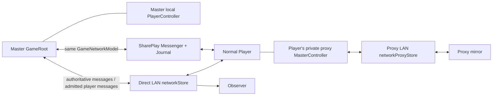
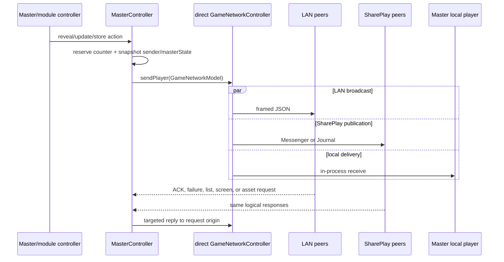
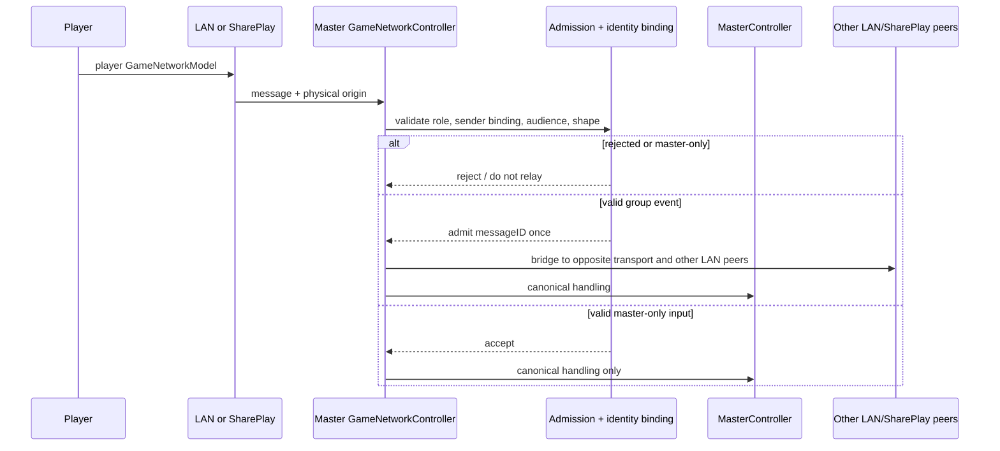
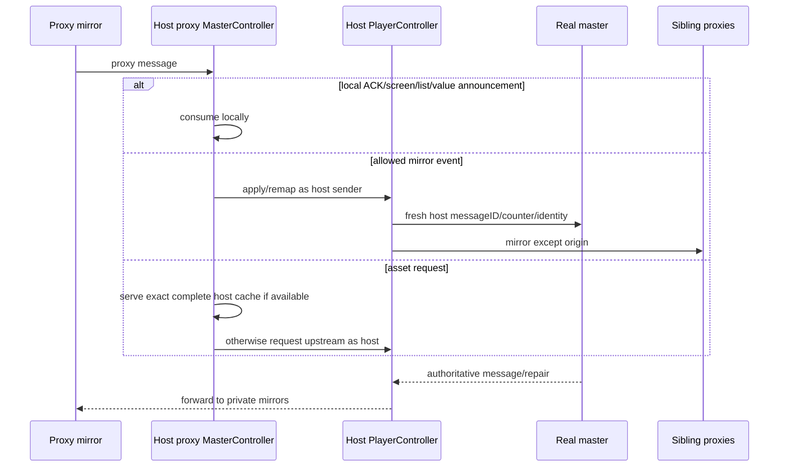

# Game Message Communication Flow Review

Review date: 2026-07-19.

This is the focused architecture and code review for game-state communication.
The exhaustive module-by-module behavior remains in
[Game Connections](GAME_CONNECTIONS.md). The redesign history is in
[Game Communication Redesign](GAME_COMMUNICATION_PLAN.md).

## Review Outcome

The communication architecture is coherent and substantially hardened:

- the master is the sole authority for roster, controls, features, and game state
- the physical route is kept separate from the logical sender identity
- LAN connections and SharePlay participants are pinned to immutable logical
  identities during a session
- audience and message purpose are validated from the protocol tuple; a sender
  cannot make a master-only message peer-visible merely by setting `.group`
- LAN/SharePlay bridging is deduplicated and admits only a small allowlist of
  complete player events
- SharePlay Journal bytes are accepted only after physically attributed Messenger
  metadata with a matching identity fingerprint and SHA-256 payload digest
- processing, package sending, and Journal publication are ordered and bounded

The main remaining risks are at the LAN boundary and the compatibility boundary:

1. the LAN framer trusts an unbounded `UInt32` body length
2. every installation shares one fixed TLS PSK, so TLS is encryption but not
   session/user authentication
3. LAN sends have no bounded application queue or observable send completion
4. old peers have no capability negotiation for new action values or logical
   `targetId` behavior

## 1. State And Authority

“All state” spans two different concepts that should not be conflated:

| State | Owner | Wire behavior |
| --- | --- | --- |
| Session lifecycle (`stopped`, `prepare`, `started`) | `GameRootModel.gameConfig` | Included in authoritative `masterState` |
| Master identity and adventure | Master | Included in every complete `masterState` |
| Roster | Master | Included in `masterState.players` |
| Per-player sharing controls | Master | Included in `masterState.controls` |
| Feature gates | Master | Included in `masterState.features` |
| Module presentation/cache state | Module controllers | Commands and asset messages in `data` |
| Connection lifecycle | Each transport controller | Local only; never authoritative game state |

`GameRoot.startMaster()` moves directly from stopped to started. A joining
participant moves from stopped to prepare while connecting, then to started after
`PlayerController.start` succeeds. Stopping clears the controllers and resets the
local game configuration.

Every master-originated message takes one `MainActor` snapshot of the sender and
the complete master state. A player-originated message carries only its sender.
Legacy roster/control fields are still encoded for older binaries, but they do
not change the current authority boundary.

## 2. Components And Connections



`GameRoot` owns two `GameNetworkController` instances:

- `networkStore` is the direct controller. It owns direct LAN and the process-wide
  SharePlay controller, and it may bridge admitted group events between them.
- `networkProxyStore` is the private proxy controller. It is LAN-only and never
  participates in SharePlay or generic transport fan-out.

### Role And Connection Matrix

| Role | Upstream connection | Listener/browser | SharePlay | Logical identity seen by real master |
| --- | --- | --- | --- | --- |
| Master | None | Advertises `.player`; browses player fallback `.master` | Creates/joins | Master UUID |
| Master’s local player | In-process delivery | None | No independent participant | Master UUID |
| Player | Direct LAN or SharePlay | Browses `.player`; advertises fallback `.master` after loss | May join | Player UUID |
| Observer | Direct LAN only | Browses `.player` | Prohibited | Observer UUID |
| Proxy host | Same normal player | Advertises `.proxyServer`; browses proxy fallback `.proxyClient` | None on proxy leg | Host player UUID |
| Proxy mirror | Private proxy LAN only | Browses `.proxyServer`; advertises fallback `.proxyClient` after loss | Prohibited | Invisible; messages are remapped to host |
| Demo | In process | None | None | Local demo identity |

The real master does **not** start a proxy listener. Each normal player starts its
own private proxy listener and acts as the authority for its mirrors.

### Bonjour Services

| Service | Advertised by | Browsed by | String |
| --- | --- | --- | --- |
| `.player` | Real master | Player/observer | `_gamemastermaster._tcp` |
| `.master` | Direct player fallback | Real master | `_gamemasterplayer._tcp` |
| `.proxyServer` | Normal player’s proxy master | Proxy mirror | `_gamemasterproxyserver._tcp` |
| `.proxyClient` | Proxy fallback | Normal player’s proxy master | `_gamemasterproxyclient._tcp` |

## 3. Message Envelope

All transports carry `GameNetworkModel`:

```swift
GameNetworkModel(
    version: Int,
    messageID: UUID?,
    replyToMessageID: UUID?,
    timestamp: TimeInterval,
    counter: Int,
    proxyCounter: Int,
    type: RPGMessageType,
    subType: RPGMessageActionType,
    masterId: UUID,
    sender: GameSenderModel,
    masterState: GameMasterStateModel?,
    targetId: UUID?,
    audience: GameMessageAudience,
    purpose: GameMessagePurpose,
    journalAdmissionOnly: Bool?,
    journalPayloadDigest: Data?,
    data: NetworkCodableDataType
)
```

The important identities are deliberately independent:

- `messageID` identifies one logical send across transport retries and bridges
- `replyToMessageID` correlates an ACK or asset request to the master command
- `counter` is monotonic only within one sender; it is not a global clock
- `timestamp` orders allowed last-wins peer events and is rejected when invalid
  or more than five minutes in the future
- `sender.id` is the logical participant UUID
- `GameMessageOrigin` is the physical route: direct connection, proxy connection,
  SharePlay participant, Journal file callback, or local delivery
- `targetId` is a logical recipient; the physical transport is still selected
  from `GameMessageOrigin` when a reply must return to its requester

The in-memory schema is version 2. Encoding deliberately advertises wire version
1 and emits a compatibility superset containing both current and legacy state.

### Audience And Purpose

| Effective audience | Examples | Bridge behavior |
| --- | --- | --- |
| `.master` | ACK/failure, availability lists, screen, map state report, asset request | Never fan out |
| `.group` | Master commands; valid player dice roll, map pin, space transform, photo/PDF/space reveal | May bridge once |
| `.target` | Asset repair or replay for one participant | Send to original physical route when possible; never group-relay |

`purpose` separates a user event from an asset repair. This is important for a
proxy host: a data-less reveal can otherwise look like either a presentation or
a request for missing bytes.

## 4. Authoritative Master Flow



The master message is canonical before transport fan-out. Receivers apply a
complete, newer `masterState` atomically, then run the module handler. Replies
echo the answered counter, set `replyToMessageID`, and strip incoming payload
bytes. A missing receiver requests a full payload instead of falsely ACKing an
ID-only message it cannot apply.

## 5. Direct Player And Cross-Transport Flow



The allowlisted player group events are intentionally narrow:

- complete dice roll
- complete map pin update
- complete space transform
- full photo, PDF, or space reveal event

ACKs, failures, cache availability, screens, lists, value changes, audio, table,
weather, asset requests, and malformed/incomplete event shapes remain master-only.
The master canonicalizes or rejects those inputs before publishing any result.

SharePlay adds two identity rules:

1. a physical `GroupSession.Participant.id` is pinned to one logical player UUID
2. after a player accepts a complete master bootstrap, it pins that physical
   participant as the only master authority

A short, byte-bounded queue retains only dice/map-pin/space-transform events that
arrive just before the roster entry that authenticates a newly joining player.
The next accepted master state drains and revalidates them.

## 6. Proxy Flow



Proxy identity never crosses the upstream boundary. The proxy host consumes
mirror-only bookkeeping; eligible dice, map-pin, space-transform, and file
presentation events are rebuilt as host messages. Table actions always go to the
real master. On proxy readiness, the host replays the current presentation and a
complete copy of the host character package.

When a master reply targets the host, the host clears that target before sending
the repair to its own mirrors. A target for another logical participant remains
unchanged because that participant might be behind a different proxy host.

## 7. Observer Flow

Observers are Bonjour/LAN-only and have no character. The domain boundary rejects
an observer start with no Bonjour target, preventing accidental SharePlay join.

The master normalizes observer input to a passive allowlist:

- ACK or failure
- availability-list report
- screen sample
- data-less, exact asset repair request

Gameplay uploads and player actions are rejected. Observers receive authoritative
master content but do not mutate gameplay state.

## 8. SharePlay Messenger And Journal

SharePlay carries the same envelope through two transports:

### Messenger

- serial whole-message FIFO
- 64,000-byte raw chunks
- 64 MB maximum message
- at most 16 queued whole messages and 128 MB outstanding
- two retries for a transient package send failure
- physically targetable to one SharePlay participant
- receive-side limits for streams, chunks, bytes, and 120-second expiry

Messenger is used for small messages, metadata, map structural updates, and
targeted non-Journal repairs.

### Journal

Journal is used only when the caller opted into file transport, a configured
journal exists, and the payload contains bytes. It accepts untargeted file
payloads plus targeted audio and Weather repairs. A targeted audio repair becomes
an untargeted cache store; a targeted Weather repair retains its logical target.

Journal does not expose the attachment publisher. Therefore each Journal send has
two parts:

1. Messenger sends metadata from a known physical participant with
   `journalAdmissionOnly == true` and a SHA-256 digest.
2. Journal delivers metadata plus bytes. The receiver recomputes the digest and
   releases the callback only if the entire immutable fingerprint matches.

Admissions, early Journal callbacks, publication work, cleanup work, and bytes
are bounded. Presentation publications are latest-wins per module; targeted
repairs retain FIFO semantics. Character/value messages never use Journal: a
player first sends the character ID/version reference, and the master requests
the full package only on mismatch.

## 9. Ordering, Deduplication, And Concurrency

- `GameMessagePipeline` is an actor-backed FIFO. A successful message is retained
  in a bounded recent set; failure releases its key so a full-payload retry can run.
- Stable deduplication uses sender plus `messageID` and payload presence. Legacy
  positive counters remain the fallback.
- Sender counters start at 1 and are independent. They must never be compared
  between different players or between a player and the master.
- Master-state snapshots are accepted only when newer for that master, except
  legacy counter zero.
- Presentation intent and payload completion are tracked separately so delayed
  Journal bytes cannot restore an obsolete screen.
- Map presentation, structural update, and volatile map state use separate
  ordering/recovery paths.
- `GameRoot`, observable controller/network models, and SharePlay mutable state
  are `@MainActor`. Sendable controller objects reach that state through
  actor-isolated methods or explicit `MainActor` hops. Connection/framing work is
  actor-isolated and callback APIs hop back into actors.
- The custom `DispatchQueue` in `ConnectionController` exists because
  `NWConnection.start(queue:)` requires one; mutable connection coordination
  remains inside the actor.
- The one `Task.detached` is limited to synchronous `GroupSession.join()` to avoid
  blocking the main actor during an active audio session. It is stored, cancelled,
  and leaves the obsolete session if cancellation races the join.

## 10. Loss, Reconnection, And Replay

| Layer | States | Recovery behavior |
| --- | --- | --- |
| Game session | stopped → prepare → started | Failed join returns to stopped |
| Browser/listener UI | cancelled/stopped → connecting → waiting | AsyncStream drives observable state |
| Player connection | notReady → ready → lost | Lost direct player advertises `.master`; master browses and reconnects |
| Proxy connection | notReady → ready → lost | Lost proxy advertises `.proxyClient`; host proxy master reconnects |
| SharePlay | inactive → waiting → joined → disconnected | Session replacement tears down old participants/tasks before new configuration |

Connection callbacks are accepted only from the current connection ID, so a late
failure from a replaced connection cannot tear down the replacement. A newly
ready player receives current authoritative state; a ready proxy receives the
host presentation and character bootstrap. SharePlay participant replay is
session-scoped and happens once per join generation.

## 11. Review Findings

### High — LAN frame length is not bounded

`GameProtocol.handleInput` converts the peer-supplied `UInt32` header length to
`Int` and passes it directly to `deliverInputNoCopy`. There is no maximum encoded
message size before buffering or JSON decoding. A peer that can establish the
PSK connection can announce a very large frame and create memory/connection
pressure.

Recommendation: define one LAN encoded-message limit, reject/close the connection
before delivery when `header.length` exceeds it, and apply a second decoded
payload-byte limit appropriate to the module protocol. Add boundary tests for
limit − 1, limit, limit + 1, truncated bodies, and repeated oversized headers.

### High on untrusted LAN — the TLS PSK is global and fixed

`GameSecurity.passcode` is the application constant `GameMasterCode`. This gives
encryption and protocol separation, but possession of the app or extracted
constant is enough to establish the transport. Logical role/session checks block
many authority-spoofing attempts, but they do not make the peer an authenticated
invited user and do not prevent resource-exhaustion traffic.

Recommendation: derive a short-lived session PSK from an invitation/pairing code,
store no reusable secret in the binary, and rotate it per game. Keep the current
logical admission checks as defense in depth.

### Medium — LAN sends have no application backpressure or delivery result

`ConnectionController.request/response` calls `NWConnection.send` with
`.idempotent`. The call is not tied to an awaited completion, retry policy, or a
bounded per-connection application queue. A slow or failing peer can therefore
accumulate framework-buffered work, and the caller cannot associate a send
failure with `messageID`. Higher-level ACKs help for many commands, but do not
cover every message.

Recommendation: add one bounded serial sender actor per connection, observe send
completion, fail the connection or message deliberately on terminal error, and
define which message classes may be coalesced versus must remain FIFO.

### Medium — compatibility is schema-shaped, not capability-negotiated

The encoder emits a V1 compatibility superset, but an older binary still cannot
decode an enum case it does not know, such as `.photoList`. It also cannot enforce
new logical-target or purpose semantics merely because current peers emitted the
extra keys. Physical targeting protects direct routes; broadcast/fallback paths
cannot assume an old receiver understands `targetId`.

Recommendation: add a connection/session hello with supported envelope version,
action values, target filtering, Journal admission, and module capabilities.
Select routes and subtypes from the negotiated intersection, and reject unsupported
required capabilities before joining the game.

### Low — browser state exposes unreachable cases

`NetworkState.connected` and `.tlsFailed` are declared, but neither
`BrowserManager` nor `ListenerManager` assigns them. Connection readiness lives
in `PlayerNetworkNodel.ConnectionState`, and TLS failure is folded into stopped.
This makes the UI state type imply behavior that does not exist.

Recommendation: remove the unused cases or map real events to them and test the
transitions. Prefer separate browser, listener, and connection state types if
their meanings continue to differ.

### Constraint — SharePlay is a process-wide singleton

Both direct and proxy `GameNetworkController` instances reference
`RPGSharePlay.store`; only direct mode uses it. This correctly avoids proxy loops,
but it assumes one active `GameRoot`/SharePlay game per process.

Recommendation: document this as an application invariant. If multi-window games
become a requirement, inject a session-scoped SharePlay controller instead.

### Test gap — real transport failure combinations

The unit suite is strong for routing, spoof rejection, identity pinning, Journal
admission/digests, package bounds/retries/expiry, session replacement, and proxy
flows. The reviewed tests primarily use models and test doubles; they do not prove
multi-device Bonjour/TLS behavior, real GroupSession delivery, or simultaneous
LAN/SharePlay loss and reconnection.

Recommendation: add a small manual/integration matrix for two physical devices:

- LAN-only, SharePlay-only, and mixed LAN/SharePlay sessions
- player moves between Wi-Fi interfaces and master reconnects through fallback
- duplicate delivery over both transports
- SharePlay participant leaves/rejoins while a Journal asset uploads
- proxy host loses upstream while mirrors remain connected
- oversized/truncated LAN frames and a slow-reading peer
- current/previous supported app-version interoperability

## 12. Verified Strengths

No change is recommended to these boundaries:

- master-only `GameMasterStateModel`
- `GameMessageOrigin` separate from logical identity and target
- immutable physical-to-logical sender binding
- canonical audience inference that cannot be widened by player input
- bridge allowlist plus sender/message/payload-aware admission
- Journal Messenger admission and recomputed payload digest
- byte/count/time bounds throughout the SharePlay package and Journal queues
- target-preserving reply routing
- proxy identity invisibility and host remapping
- observer passive allowlist
- actor FIFO processing and current-connection callback filtering

## 13. Source And Test Index

Primary implementation:

- `Modules/GameRPG/Model/GameNetworkModel.swift`
- `Modules/GameRPG/Root/GameRootModel.swift`
- `Modules/GameRPG/Network/GameNetworkController.swift`
- `Modules/GameRPG/Network/GameProtocol.swift`
- `Modules/GameRPG/Network/ConnectionController.swift`
- `Modules/GameRPG/Master/MasterNetworkController.swift`
- `Modules/GameRPG/Player/PlayerNetworkController.swift`
- `Modules/GameRPG/Controller/MasterController.swift`
- `Modules/GameRPG/Controller/PlayerController.swift`
- `Modules/GameRPG/SharePlay/RPGSharePlayController.swift`
- `Modules/GameRPG/SharePlay/SharePlayPackageSender.swift`
- `Modules/GameRPG/SharePlay/SharePlayPackageReceiver.swift`
- `Modules/GameRPG/SharePlay/SharePlayJournalPublicationQueue.swift`

Relevant coverage:

- `Tests/GameRPGTests/NetworkStoreTests.swift`
- `Tests/GameRPGTests/SharePlayPackageTransportTests.swift`
- `Tests/GameRPGTests/MasterPlayerControllerTests.swift`
- `Tests/GameRPGTests/MultiConnectionTests.swift`
- `Tests/GameRPGTests/GameMessageCorrectnessRegressionTests.swift`
- module flow tests under `Tests/GameRPGTests/*MessageFlowTests.swift`

Verification performed for this review:

```text
xcodebuild -project MasterRPG.xcodeproj -scheme GameRPGTests \
  -destination 'platform=iOS Simulator,name=iPhone 17 Pro' \
  -only-testing:GameRPGTests/NetworkStoreTests \
  -only-testing:GameRPGTests/SharePlayPackageTransportTests test
```

Both focused suites passed on 2026-07-19 using fresh DerivedData. They cover the
documented bridge, authority, target, Journal-admission, ordering, queue-bound,
retry, expiry, and session-lifecycle invariants. Real multi-device transport
behavior remains the integration gap described above.
