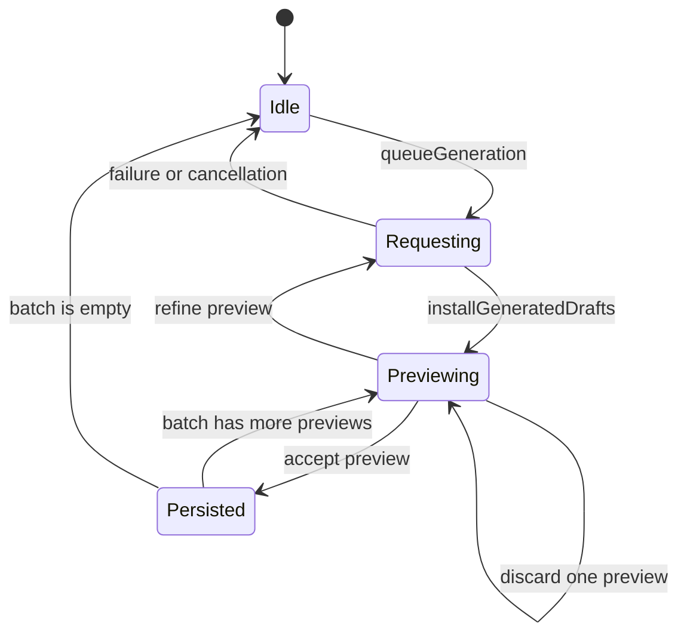

# Sheet System

This document explains how `SheetRootModel` and `SheetRootView` turn module data
into the recursive sheets used by editors, viewers, game windows, AI generation,
and structured import review.

Related docs:

- [Controllers](CONTROLLERS.md)
- [Root Models And Setup](ROOT_MODELS.md)
- [Link System](LINKS.md)

## Short Answer: How Many Modes?

`SheetRootView` has **two base presentation modes**:

1. **Viewer mode**: `isEditor == false`
2. **Editor mode**: `isEditor == true`

Several other states change what is displayed, but they are not additional
mutually exclusive presentation modes:

| State dimension | Values | Purpose |
| --- | --- | --- |
| AI assistant | inactive / active | Expands the single root-owned composer and accepts generation requests. |
| Search | empty / active query | Filters rows, expands matching branches, and highlights matches. |
| Selection | none / one selected occurrence | Drives row highlighting, keyboard navigation, scrolling, and focused commands. |
| Viewer quick edit | closed / one editing row | Shows an inline value editor in viewer mode. |
| Generated content | idle / requesting / previewing | Keeps AI drafts transient until accepted. |
| Import review | ordinary / decorated | Adds Existing, Merge, and New alternatives to affected rows. |

There are also two separate enums that are sometimes mistaken for view modes:

- `SheetModelEditType` has **five values**: `none`, `number`, `decimal`,
  `selection`, and `text`.
- `SheetModelType` has **eight row types**: `item`, `group`, `audio`, `dice`,
  `pdf`, `photo`, `space`, and `weather`.

## Responsibility Map

```mermaid
flowchart TD
    "Module xRootModel" --> "ItemRootController"
    "ItemRootController" --> "Module SheetControllable"
    "Module SheetControllable" -->|"materializes"| "SheetModel tree"
    "SheetRootModel" -->|"owns"| "SheetModel tree"
    "SheetRootModel" -->|"resolves modules through"| "RootManager"
    "SheetRootView" --> "SheetView"
    "SheetView" -->|"recursively renders"| "SheetEntryView"
    "SheetEntryView" -->|"actions"| "SheetRootModel"
    "SheetRootModel" -->|"persists through"| "EntryDataEditable"
    "SheetRootModel" -->|"reconciles through"| "Module SheetControllable"
```

The types have deliberately different jobs:

- `SheetController` in each module maps domain items and entries into
  `SheetModel` nodes and updates existing nodes from current domain data.
- `SheetModel` is one observable occurrence in the rendered tree. Its stable
  `id` identifies the occurrence, even when the same domain item appears in
  multiple branches.
- `SheetRootModel` coordinates state and actions shared by the whole tree.
- `SheetRootView` is the public rendering shell.
- `SheetView` recursively renders sheet headers, inline rows, regular entries,
  linked child sheets, generated previews, and optional detail content.
- `SheetEntryView` renders one entry and exposes the controls appropriate to its
  row type and current state.

## Construction

`SheetRootModel` is `@MainActor` and `@Observable`. It has four construction
paths:

1. Build a live sheet and create a new `SheetEditorModel`.
2. Build a live sheet with a shared `SheetEditorModel`, normally the module
   editor's instance.
3. Build a structured import-review sheet and decorate it with three materialized
   versions: Existing, Merge, and New.
4. Accept an already-built `SheetModel` tree for previews, tests, and generated
   chat content.

For a live sheet, construction calls:

```swift
sheetControllable.sheet(
    root: rootManager,
    itemId: itemId,
    destination: nil,
    level: 0,
    isShown: true,
    moduleDepth: 0,
    isEditor: isEditor
)
```

The module controller decides which inline media and entries exist, whether
linked sheets begin folded, and how deep initial materialization may go.

The model's `isEditor` value is fixed at construction. It affects how module
controllers materialize and later update the tree. The `isEditor` passed to
`SheetRootView` controls which UI actions are visible. These values must match.

## Rendering

`SheetRootView` passes the root `SheetModel` to `SheetView` and gives the
subtree a new SwiftUI identity when `sheetModel.id` changes.

`SheetView` renders in this order:

1. Optional header/name row.
2. Inline item media.
3. Root description.
4. Regular entry rows.
5. Caller-supplied detail content.
6. Legacy embedded generated rows.
7. Transient generated previews at their requested position.
8. Linked child sheets whose `isShown` value is true.

The same `SheetRootModel` is passed through the entire recursive tree. This is
why selection, search, editing, and generated-preview placement have one source
of truth across modules.

## Viewer Mode

Viewer mode is the normal read/game presentation:

- Links can materialize, unfold, expand, and collapse child sheets.
- A row can be selected.
- Generated chat answers can be selected.
- Entries with an editable `SheetModelEditType` can open one inline quick editor.
- Editor-only add, delete, reorder, drag, and focused command actions stay hidden.

`SheetRootModel.toggleInlineEditing` guarantees that at most one viewer quick
editor is open. Opening another row closes the previous row in the same
main-actor state change.

## Editor Mode

Editor mode adds:

- add-entry and add-group controls
- delete and duplicate actions
- move up/down and folder actions
- drag reordering and cross-item movement
- link drop destinations
- entry edit-type selection
- focused menu commands through `SelectedSheetEntry`

Mutations do not edit `SheetModel` as the persistence authority. They call the
module's `EntryDataEditable` or another edit controller, then call
`updateParent` or `updateFromRoot` to reconcile the displayed tree.

## Selection And Keyboard Navigation

Selection uses `SheetModel.id`, not domain item or entry identifiers. This is
important because one domain item can appear more than once in a recursive
sheet.

`setSelected(_:parent:)`:

1. Clears the previously selected occurrence.
2. Marks the new occurrence selected.
3. Stores both the row and its parent.
4. Sets a scroll target when the row represents a domain entry.

Outside tvOS, `SheetRootView` handles:

- Down Arrow: next visible top-level entry.
- Up Arrow: previous visible top-level entry.
- Escape: clear selection.
- Left Arrow: clear selection and return navigation focus to the list column.

Only editor-mode selections are published as a focused `SelectedSheetEntry` for
menu commands.

## Link Expansion

Link text is rendered by cached `LinkHighlightTextModel` instances. Their toggle
callback returns to `SheetRootModel` with:

- the source row occurrence
- destination item and module
- link occurrence number

The occurrence number disambiguates repeated links to the same destination.
The model first looks for an existing linked sheet with the same destination and
occurrence. If none exists, it asks the destination module's `SheetControllable`
to materialize one, unfolds it, and appends it to the correct occurrence.

See [Link System](LINKS.md) for URL and occurrence-number details.

## Search

Search is owned by `SheetRootModel.searchText`.

When the first non-empty query begins:

1. The current `isShown` value of every regular tree node is saved in
   `lastIsShown`.
2. `SheetModel.filter` recursively marks non-matching branches hidden.
3. Ancestors of matches expand so results are visible.
4. Cached link-text models receive the query for highlighting.

When the query is cleared after an active search, the saved expansion state is
restored.

`SheetSearchContext` lets an outer game window own the search field while
attaching its query to whichever `SheetRootModel` is currently presented.

## AI Generation

AI assistance is optional and owned by the parent presentation, never by
`SheetRootView`, `SheetView`, or `SheetEntryView`:

- Adventure, Character, Map, and Table attach one assistant to their
  `DetailListView`.
- Adventure game mode supplies one assistant to the parent `TableRootSheet`.
- `SheetRootModel.isAIModeActive` controls whether that one composer is expanded.

On iPhone, the same single parent-owned assistant is hosted by the native tab
accessory instead of a content overlay. It takes priority over the audio
mini-player while the sheet is visible; outside sheet screens the mini-player
can use the accessory when audio is available. While Ask AI is present, tab-bar
minimization is disabled so the assistant surface does not jump between expanded
and inline placements. The native accessory starts as one Ask AI button. Because iOS
does not expose a text field inside `tabViewBottomAccessory` as hittable, activating
the button disables that accessory and presents the single request field in a
keyboard-capable bottom `safeAreaBar` one level above it. The custom active bar uses
interactive Liquid Glass; it disappears when the request field closes.
Generated previews keep their own context-menu actions because those actions manage
the individual transient result rather than creating another Ask AI input.

The generation flow is:



`queueGeneration` produces an immutable `SheetGenerationRequest` containing:

- an immutable snapshot of relevant sheet content
- optional focused row content
- destination parent and insertion position
- the destination module
- request and root item identities

The Generator module performs asynchronous work. A result is installed only if
the request is still current and belongs to the same root item. Drafts remain
outside the persisted `SheetModel.entries` collection in `SheetGeneratedBatch`.
`SheetView` splices them into the requested visual position.

Accepting a preview calls `EntryDataEditable.insertEntry`, reconciles the parent
sheet, selects and scrolls to the persisted row, and temporarily matches the
preview and persisted row geometry for the transition.

## Structured Import Review

The review initializer builds four views of the same item:

- the currently selected materialization
- Existing
- Merge
- New

`SheetReviewTreeBuilder` keeps the current sheet's ordering authoritative,
decorates changed rows with alternatives, and inserts non-mutating placeholders
for rows omitted by the selected version. Choosing another alternative changes
the review decision model; the owning import view rebuilds the materialized
sheet.

Review selection is intentionally independent from normal row selection and
generated-answer selection.

## Concurrency Boundary

The project uses Swift 6 with complete strict concurrency and no default
main-actor isolation. The sheet types therefore declare their isolation:

- `SheetRootModel`, `SheetModel`, and `SheetEditorModel` are explicitly
  `@MainActor`.
- Mutable tree traversal and controller mutation stay on the main actor.
- `SheetGenerationRequest`, `SheetGenerationFocus`, `SheetContentSnapshot`, and
  `GeneratedSheetDraft` are immutable `Sendable` values.
- SwiftUI `.task(id:)` owns generation lifetime and cancels obsolete requests
  when request identity changes.

This keeps mutable observable references out of the asynchronous generation
boundary.

## Reset And Refresh

`reset(itemId:)` reuses the `SheetRootModel` instance for another item. It:

- materializes the new root tree
- updates editor identity
- clears link renderer caches
- clears search, selection, inline editing, and AI state

Reusing the root model prevents view-owned model construction from leaking
Observation dependencies into parent view evaluation.

`updateParent(_:)` reconciles one editable subtree. `updateFromRoot()` refreshes
the complete tree when a change can affect calculated or cross-linked values.

## Test Coverage

Current focused coverage includes:

- stable occurrence identity and exclusive selection
- focused editor values
- viewer quick-editor exclusivity
- link occurrence toggling
- AI request focus and insertion positions
- stale request and preview rejection
- preview replacement, refinement, acceptance, and deletion
- structured review materialization, ordering, and placeholders
- external `SheetSearchContext` attachment

Important gaps identified during review:

- editor/viewer mode agreement between model and view
- root and nested link-text cache invalidation
- keyboard selection scrolling with locally owned editor state
- drag reordering in both directions
- search state after structural mutations
- cache eviction after entry deletion

## Source Guide

- `Modules/CoreRPG/Sheet/SheetRootModel.swift`
- `Modules/CoreRPG/Sheet/SheetRootView.swift`
- `Modules/CoreRPG/Sheet/SheetView.swift`
- `Modules/CoreRPG/Sheet/SheetEntryView.swift`
- `Modules/CoreRPG/Sheet/SheetModel.swift`
- `Modules/CoreRPG/Sheet/SheetEditorModel.swift`
- `Modules/CoreRPG/Sheet/SheetSearchContext.swift`
- `Modules/CoreRPG/Sheet/SheetReviewModels.swift`
- `Modules/CoreRPG/Sheet/TableRootSheet.swift`
- `Modules/CoreRPG/Sheet/TableSheetView.swift`
- `Modules/GeneratorRPG/View/SheetAIAssistantOverlayView.swift`
