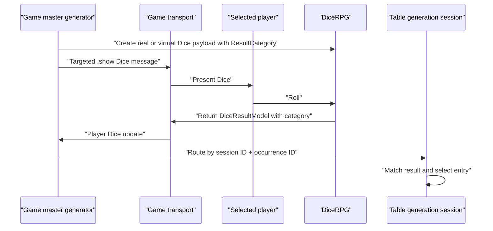

# Table Generator

Implementation audit: 2026-07-25.

The Table Generator turns a Table into one generated value. A generation can be
chosen manually, rolled locally, expanded through linked Tables, shared with a
specific player, or resolved by asking a player to roll. Confirming the final
path produces a generator-backed Character `ValueEntryModel`.

The feature is available on iOS, macOS, and visionOS. It is not presented on
tvOS.

Related documentation:

- [Controllers](CONTROLLERS.md)
- [Game Connections](GAME_CONNECTIONS.md)

## 1. User Flow

The normal flow is:

1. Open **Generate** for a Table.
2. Select one entry from the root Table, or use **Auto Roll**.
3. If the selected entry contains Table links, resolve every linked Table that
   appears below it.
4. Continue until every visible Table section has one selected entry.
5. Optionally share the completed result with a player while a game is running.
6. Choose **Confirm** to create the local generated value, or **Cancel** to
   discard the generation.

Selecting one entry hides its siblings. Selecting that entry again deselects
it, shows its siblings again, and removes any linked Table sections that were
created from it.

```mermaid
flowchart TD
    "Open Generate for a Table" --> "Root Table section"
    "Root Table section" --> "Select manually or Auto Roll"
    "Select manually or Auto Roll" --> "Selected entry has Table links?"
    "Selected entry has Table links?" -- "No" --> "All visible sections selected?"
    "Selected entry has Table links?" -- "Yes" --> "Append every linked Table"
    "Append every linked Table" --> "Resolve each child Table"
    "Resolve each child Table" --> "All visible sections selected?"
    "All visible sections selected?" -- "No" --> "Resolve remaining section"
    "All visible sections selected?" -- "Yes" --> "Share with player (optional)"
    "Share with player (optional)" --> "Confirm or Cancel"
```

## 2. Entry Points

### Table list context menu

The context menu for a normal Table row in `ListRootView` contains:

```text
Generate from <Table Name>
```

The action is shown only when:

- the current root is the Table module;
- the row resolves to a real Table;
- the Table is not a special category/folder;
- the Table root exposes an `ItemGenerationControllable`.

The presentation action is installed by
`ItemGenerationPresentationModifier` and passed through the SwiftUI
environment as `ItemGenerationAction`.

### Expanded Table links during a game

When a whole-Table link is rendered in a game sheet, its expanded actions
include **Generate** alongside actions such as Share or Show. The generated RPG
URL uses `LinkType.generate` and the reserved link-number addition `800`.

The action is added only when the sheet is in game mode and a generation action
is available. Activating the special link calls the same
`ItemGenerationAction` used by the list context menu.

This action is for whole-Table links. A link targeting one specific Table entry
does not become a child Table in the generator.

## 3. Platform Presentation

| Platform | Presentation |
| --- | --- |
| iOS / iPadOS | Animated overlay above `ListRootView` or `TableRootSheet`, with a dimmed background |
| macOS | Dedicated **Table Generator** window opened by `ScenesManager` |
| visionOS | Dedicated **Table Generator** window opened by `ScenesManager` |
| tvOS | No generator presentation |

macOS and visionOS use `SceneId.tableGenerator` and pass the selected Table ID
through `WindowItemSelection`. The window is content-sized, suppresses automatic
launch, and is placed relative to the Table link window when possible.

The generator window receives the same app theme, game state, player-sharing
actions, network actions, and result action as the main app hierarchy.

## 4. Generator Layout

The generator panel contains:

- the root Table name;
- a short selection instruction;
- **Auto Roll** in the header;
- a **Share** menu when a complete result can be sent by the game master;
- one section for every active Table occurrence;
- the last local or returned roll beside its Table;
- a waiting indicator when a player has been asked to roll;
- an inline error area;
- **Cancel** and **Confirm** buttons in the footer.

Each Table section contains:

- the Table name;
- a dice icon when the Table has a linked Dice, otherwise a numbered-list icon;
- a **Player Roll** menu when delegated rolling is available;
- the currently visible entries;
- a cycle warning when a recursive link was skipped.

**Confirm** remains disabled until every active Table section has exactly one
selection.

## 5. Table Occurrences and Selection

The generator does not mutate the stored Table. It builds an observable
generation model from Table snapshots.

Every displayed Table is represented by a `TableGenerationOccurrence` with:

- a unique occurrence ID;
- the source Table ID and name;
- Table type and optional Dice ID;
- an entry snapshot;
- nesting depth;
- the Table-ID path used for cycle detection;
- current selection;
- generated child occurrences;
- last-roll and waiting-player state.

An occurrence ID is intentionally different from its Table ID. The same Table
may appear more than once in separate branches, and each appearance must keep
independent selection and player-roll state.

### Manual selection

Selecting an entry:

1. clears the section's previous roll and waiting-player state;
2. stores the selected entry ID;
3. hides all sibling entries;
4. removes children from the previous selection;
5. scans the selected entry content for whole-Table links;
6. appends one child occurrence for every valid linked Table.

Selecting the already-selected entry performs deselection:

- the section has no selected entry;
- every sibling becomes visible again;
- all children below that selection are removed;
- cycle warnings for that selection are cleared.

To change a manual choice, deselect the current entry first, then choose another
entry.

### Multiple Table links

All valid whole-Table links in the selected entry content are appended, in
content-link order. They are siblings rather than alternatives, so every
appended Table must be resolved before confirmation.

Example:

```text
Weapon
└── Mace
    ├── Material
    │   └── Iron
    └── Condition
        └── Ancient
```

The completed generation contains three selections: Weapon, Material, and
Condition.

### Recursive links and cycles

Cycle protection is branch-local. Before appending a linked Table, the
controller checks whether that Table ID is already in the current occurrence's
path.

For example:

```text
Table A -> Table B -> Table A
```

The second Table A is skipped and shown as a recursive-link warning. The
generation can still be confirmed after the existing A and B sections are
selected.

The same Table may still appear in a different, non-recursive branch.

### Links that are not expanded

A link is not appended when:

- it targets a module other than Table;
- it targets one specific Table entry;
- the linked Table cannot be resolved;
- the linked item is a special category/folder;
- adding it would repeat a Table already in the current path.

Non-Table links remain part of the source content but are removed from the
plain-text result.

## 6. Auto Roll

**Auto Roll** begins at the root occurrence and follows the active selection
tree until every reachable path ends.

For each occurrence:

1. If it is already selected, it is not rolled again.
2. If it is unresolved and has a linked Dice, that Dice is rolled.
3. If it is unresolved and has no Dice, the generator rolls a virtual range
   from `1` through the number of entries.
4. The result is matched to an entry and selected.
5. Selecting that entry creates any linked child occurrences.
6. Auto Roll recursively resolves every child occurrence.

This means pressing **Auto Roll** after making a partial manual selection keeps
the existing choices and fills only the unresolved remainder.

An empty root Table disables Auto Roll and confirmation. An empty linked Table
or an unmatched result produces an inline error.

### Entry-name matching

A table with a linked Dice first tries to interpret the leading part of each entry
name as a number or inclusive range. A table without a Dice is rolled by position
and never reads entry names as ranges.

| Entry name | Selector |
| --- | --- |
| `1` | `1` |
| `1-3` | `1`, `2`, or `3` |
| `4 – 6` | `4`, `5`, or `6` |
| `6—4` | `4`, `5`, or `6`; endpoints are normalized |
| `10 Goblins` | `10` |
| `Mace` | No numeric selector |

The parser accepts hyphen, en dash, and em dash. It ignores common leading or
wrapping Markdown characters such as `*`, backticks, brackets, parentheses, and
spaces.

The first entry whose numeric selector contains the rolled result wins. If no
numeric selector matches, the result is used as a one-based entry index:

```text
roll 1 -> first entry
roll 2 -> second entry
```

Comma-separated selectors and non-contiguous sets are not supported. Use one
number, one inclusive range, or normal entry ordering.

### Dice size without a linked Dice

When a Table has no Dice, the entry count is the virtual die size:

| Entry count | Generated range |
| ---: | --- |
| 1 | `1...1` |
| 6 | `1...6` |
| 20 | `1...20` |

The virtual range is used both for local Auto Roll and for a delegated player
roll.

## 7. Completion and Generated Value

A generation is complete when every active occurrence has a selected entry.
Only occurrences reachable through the current selection tree are included.
Collapsed or deselected branches do not contribute to the result.

Each selected occurrence becomes an `ItemGenerationSelection` containing:

- occurrence ID;
- Table ID and plain Table name;
- entry ID and plain entry name;
- plain selected content.

RPG link markup is removed from names and content. If an entry has no remaining
plain content, its plain entry name is used as the content fallback.

### Summary formatting

`ItemGenerationSummary.name` is the root Table name.

For one selection, `value` is the selected content:

```text
Name: Weapon
Value: Mace
```

For multiple selections, the value contains one line per Table:

```text
Name: Weapon
Value:
Weapon: Mace
Material: Iron
Condition: Ancient
```

The complete structured selection list is retained alongside this display
value, so later consumers do not need to parse the formatted text.

### ValueEntryModel conversion

Confirming converts the summary into:

```swift
ValueEntryModel(
    id: summary.id,
    name: summary.name,
    type: .text,
    isGenerator: true,
    value: summary.value
)
```

The result action stores the generated entry on the active app or game model as
the hand-off point for the calling workflow.

**Cancel** unregisters the active session and dismisses the overlay/window
without producing a result. **Confirm** sends the result to the result action,
unregisters the session, and dismisses the presentation.

## 8. Sharing a Completed Result in a Game

The header **Share** menu is shown when:

- a game is running;
- the local participant is the game master;
- network actions are available;
- the generation is complete.

Only players whose sharing control is currently visible are listed. Names are
sorted using localized comparison.

Choosing a player sends a targeted message:

- payload module: `NetworkModules.generator`;
- payload ID: summary ID;
- payload version: `1`;
- message type: `.update`;
- message action: `.generatedValue`;
- target: selected player ID;
- data: encoded `ItemGenerationSummary`.

Sharing does not close the generator and does not require pressing Confirm. The
master can inspect, share, and then either confirm or cancel the local result.

The receiving player accepts the payload only when:

- the sender is the game master;
- the message type is `.update`;
- the action is `.generatedValue`;
- the summary decodes successfully.

The player stores the received summary in `GameRootModel` and sees a dismissible
Liquid Glass banner at the top of the game view with the generated name and
value.

## 9. Asking a Player to Roll

The game master can delegate the roll for any displayed Table occurrence.
The **Player Roll** menu is available when:

- a game is running in master mode;
- network actions are available;
- at least one visible player is available;
- that occurrence is not already waiting for a player result.

### Real and virtual Dice

If the Table has a linked Dice, the normal Dice game payload is created for that
Dice.

If the Table has no linked Dice, `DiceRPG` creates an in-memory virtual Dice
whose side count equals the number of Table entries and whose name is the Table
name.

Both payloads carry the same `ResultCategory` routing information:

```text
id      = generation session ID
childId = exact Table occurrence ID
module  = Table
```

The occurrence ID ensures that a returned result selects the correct section
even when the same Table appears more than once.

### Delegated-roll message flow



After a player is chosen, the section shows:

```text
Waiting for <Player Name>
```

The normal game Dice feature gate still applies. The master must allow player
Dice results for the returned roll to be processed.

### Applying the returned result

The generation session store:

1. verifies that the category targets the Table module;
2. finds the active generation by category ID;
3. finds the exact occurrence by child ID;
4. reads `DiceResultModel.sum` when it is greater than zero;
5. otherwise reads the first integer in `DiceResultModel.values`;
6. applies normal range/index matching;
7. selects the result and expands its linked Tables;
8. records the roll and clears the waiting-player state.

If no active generation session matches, the Table game controller falls back
to its legacy Table dice-result handling. Existing non-generator Table rolls
therefore continue to work.

If the returned value cannot be read, or does not match an entry, the generator
shows an inline error. A manual selection clears the waiting state. Closing the
generator unregisters the session, so a later result cannot modify the closed
generation.

## 10. Errors and Edge Cases

| Condition | Behavior |
| --- | --- |
| Root Table is missing, special, or has no entries | An unavailable/empty model is shown; confirmation is disabled |
| Linked Table is missing or special | That link is not appended |
| Selected content contains several valid Table links | Every linked Table is appended and required |
| Link repeats a Table in the current branch | Link is skipped and a cycle warning is shown |
| Dice result does not match a range and is outside entry indexes | Inline unmatched-roll error |
| Dice game payload creation fails | Waiting state is cleared and a share error is shown |
| Returned player result contains no readable integer | Inline unreadable-result error |
| Generator closes before a player result returns | Session is no longer active; closed UI is not changed |
| A selected entry is deselected | Descendant selections are discarded with that branch |
| Table data changes while an occurrence is open | Existing occurrence keeps its snapshot; recreate/reopen it to refresh |

Local Auto Roll intentionally does not re-roll selected sections. To choose a
different local result, deselect the current entry first.

## 11. Theming and Accessibility

The generator uses the normal app theme and Table tint:

- rounded themed surfaces;
- `GlassButton` for Auto Roll, Cancel, and Confirm;
- Liquid Glass effects on iOS and macOS;
- `glassBackgroundEffect` on visionOS;
- Table-tinted selection and section backgrounds;
- rounded continuous shapes throughout.

Accessibility behavior includes:

- modal accessibility traits for the iOS overlay;
- text labels for icon buttons;
- selected/not-selected values for every entry;
- hints explaining selection and deselection;
- a label for the delegated player-roll action;
- combined name/value announcement for a received generated result;
- reduced-motion-aware presentation and dismissal.

## 12. Architecture

CoreRPG owns platform-neutral generation contracts:

- `ItemGenerationAction`
- `ItemGenerationResultAction`
- `ItemGenerationSelection`
- `ItemGenerationSummary`
- `ItemGenerationControllable`

This keeps shared list, sheet, scene, and link infrastructure independent from
TableRPG and CharacterRPG.

TableRPG owns:

- `TableGenerationController`: snapshots, selection, link expansion, matching,
  local rolling, and Dice payload creation;
- `TableGenerationModel` and `TableGenerationOccurrence`: observable UI state;
- `TableGenerationSessionStore`: active-session registration and categorized
  player-result routing;
- `TableGenerationViewController`: `ItemGenerationControllable` adapter;
- `TableGenerationRootView`: platform UI;
- `GameController`: generator-first Dice result consumption with legacy fallback.

CharacterRPG owns the adapter from `ItemGenerationSummary` to
`ValueEntryModel`.

GameRPG owns:

- the generated-value message action;
- targeted summary transport;
- master-side categorized Dice-result routing;
- player-side generated-summary validation and presentation.

`TableRootModel` constructs one generation controller, session store, and view
controller, injects the session store into the Table game controller, and
exposes the view controller through `ItemRootController`.

All observable generator state is `@MainActor`. Cross-module action and payload
types are `Sendable`, and the feature uses the existing async game and Dice
interfaces rather than creating a separate transport.

## 13. Primary Source Files

- `Modules/CoreRPG/Model/ItemGeneration.swift`
- `Modules/CoreRPG/LGViews/ItemGenerationPresentationModifier.swift`
- `Modules/CoreRPG/LGViews/ListRootContextMenu.swift`
- `Modules/CoreRPG/Controllable/LinkControllable.swift`
- `Modules/TableRPG/Controller/TableGenerationController.swift`
- `Modules/TableRPG/Controller/TableGenerationViewController.swift`
- `Modules/TableRPG/Model/TableGenerationModel.swift`
- `Modules/TableRPG/Model/TableGenerationSessionStore.swift`
- `Modules/TableRPG/View/TableGenerationRootView.swift`
- `Modules/TableRPG/Controller/LinkController.swift`
- `Modules/TableRPG/Controller/GameController.swift`
- `Modules/CharacterRPG/Model/ValueEntryModel+ItemGeneration.swift`
- `Modules/GameRPG/Controller/MasterController.swift`
- `Modules/GameRPG/Controller/PlayerController.swift`
- `Modules/GameRPG/GameViews/GeneratedValueMessageView.swift`
- `Sources/MasterRPG/Window/WindowUtilityList.swift`

## 14. Tests and Validation

Behavioral coverage is concentrated in:

- `Tests/TableRPGTests/TableGenerationControllerTests.swift`
  - numeric and range selector parsing;
  - multi-link expansion;
  - sibling restoration after deselection;
  - branch-local cycle protection;
  - exact occurrence routing for categorized player results;
  - final summary name and value.
- `Tests/TableRPGTests/LinkControllerTests.swift`
  - game Table links expose and invoke Generate.
- `Tests/GameRPGTests/PlayerControllerTests.swift`
  - a master-sent generated summary is decoded and stored for presentation.

Focused test commands:

```bash
xcodebuild test \
  -scheme MasterRPG \
  -destination 'platform=iOS Simulator,name=iPhone 17 Pro' \
  -only-testing:TableRPGTests

xcodebuild test \
  -scheme MasterRPG \
  -destination 'platform=iOS Simulator,name=iPhone 17 Pro' \
  -only-testing:GameRPGTests/PlayerControllerTests
```

The implementation was verified by:

- building, installing, and launching the iOS app;
- building `MasterMac` for macOS;
- building `MasterRPG` for the visionOS Simulator;
- passing 55 TableRPG tests;
- passing 15 PlayerController tests.
